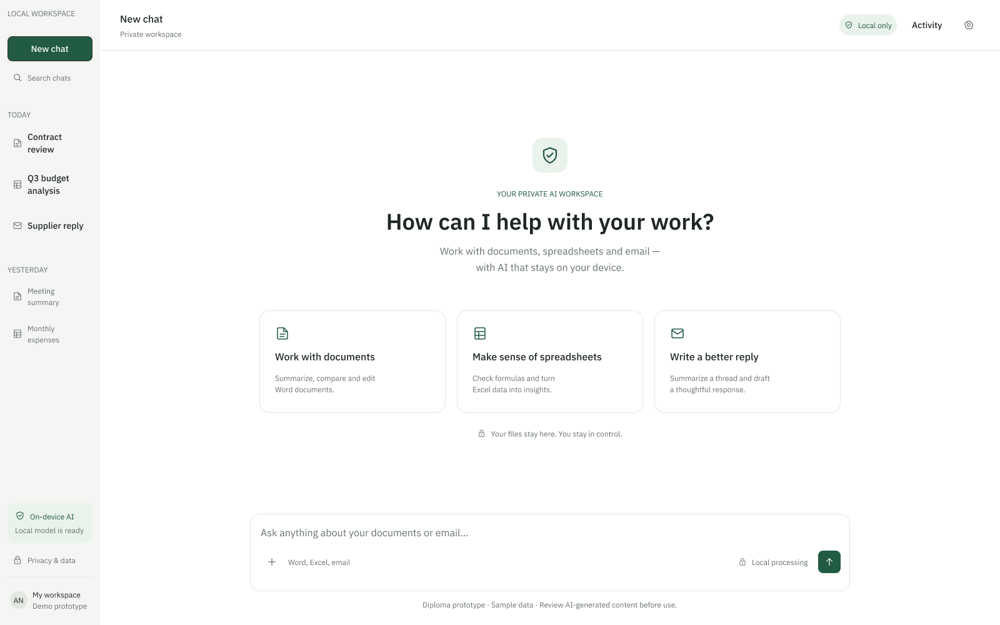
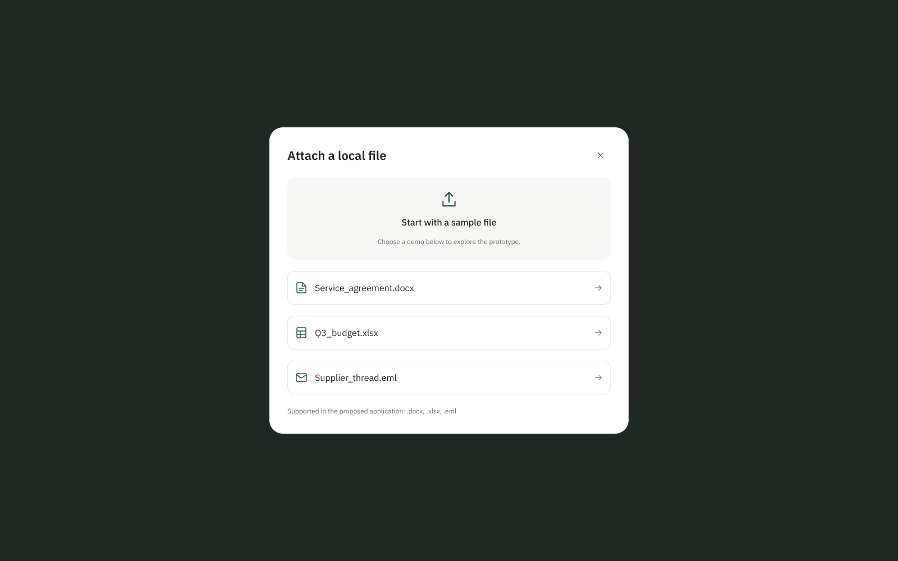
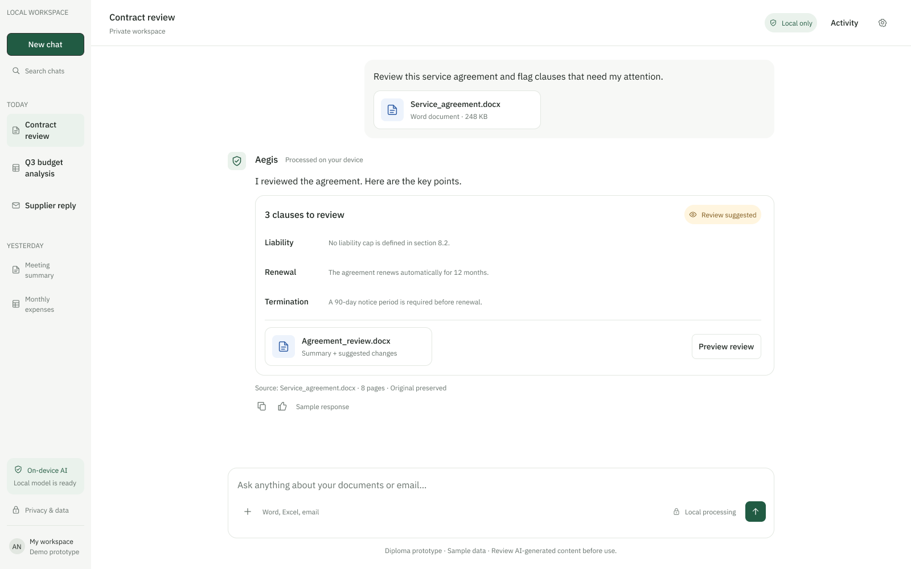
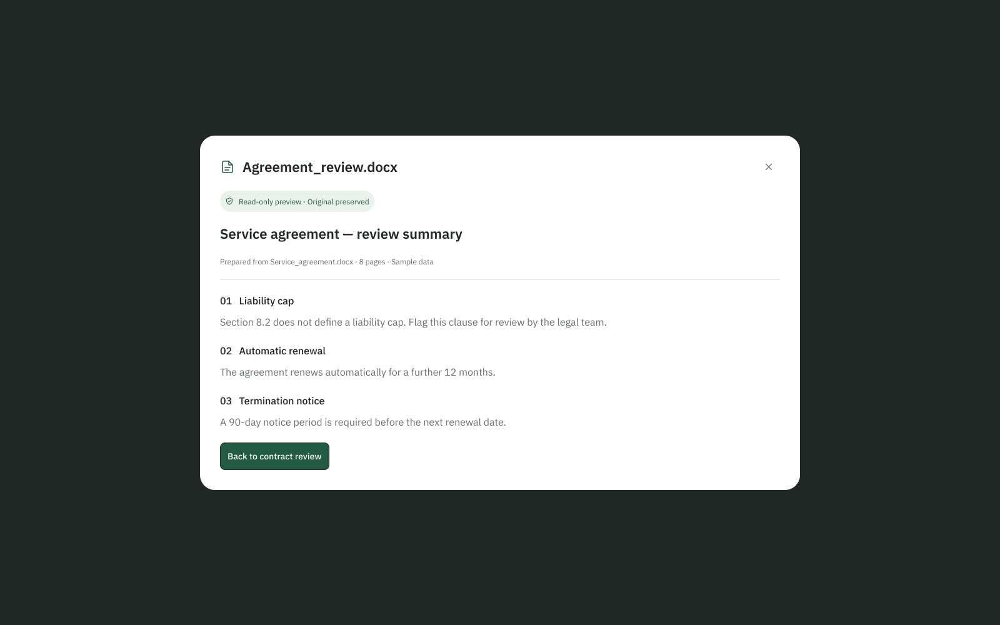
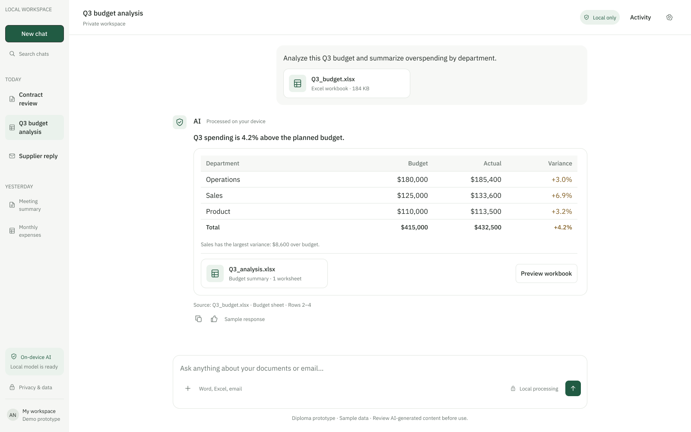
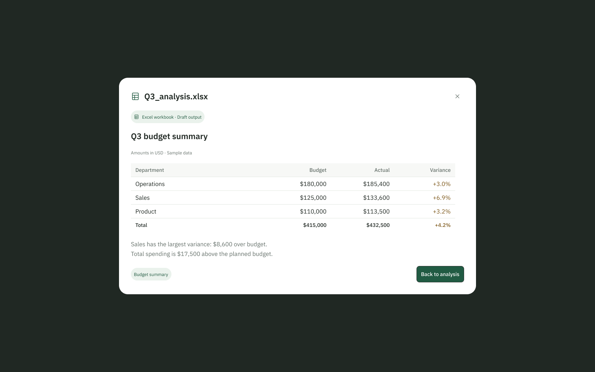
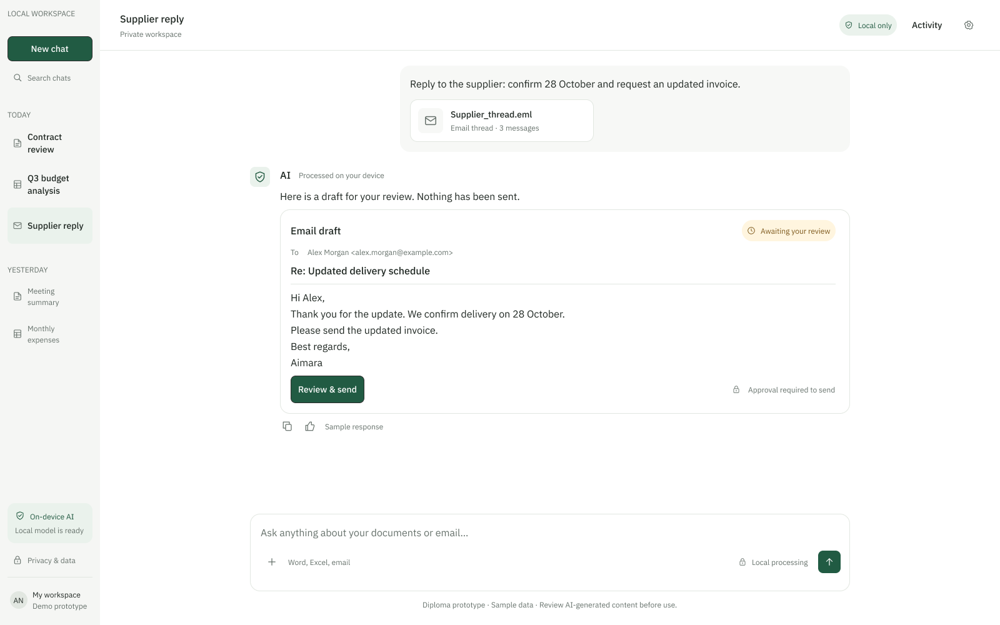
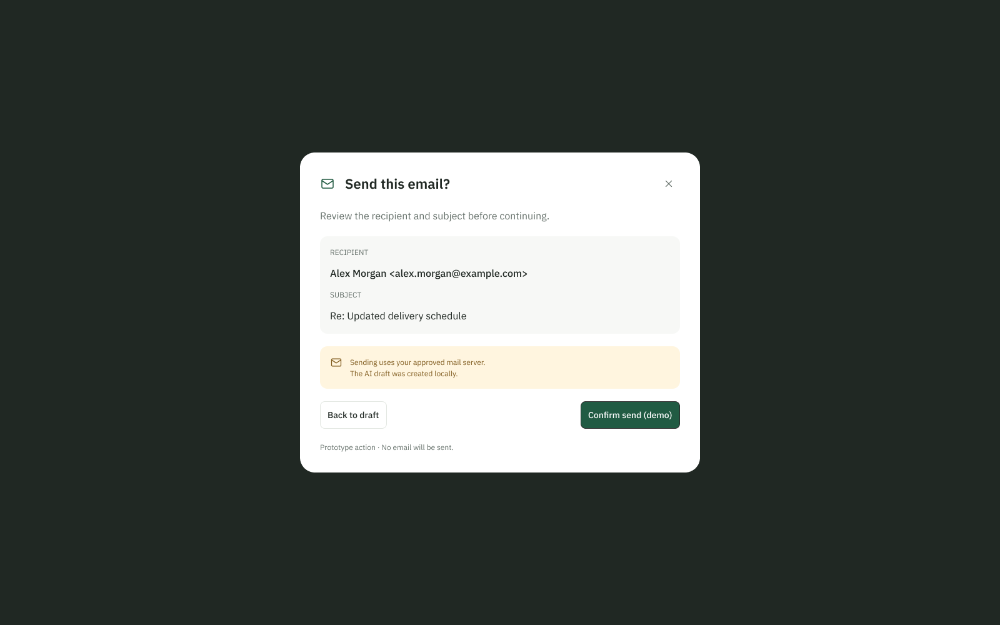
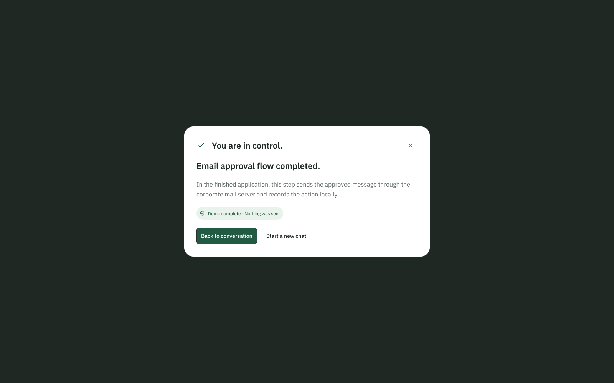
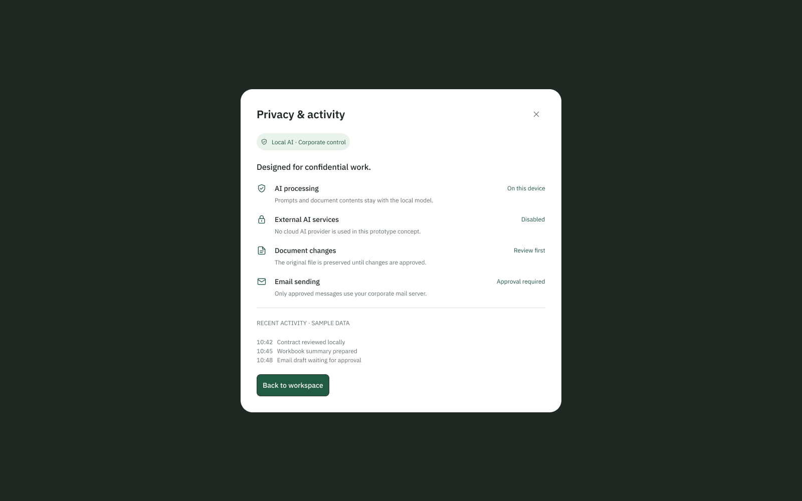

## 8.1 Interface and file selection

The prototype presents a chat interface for office tasks: reviewing documents, analysing spreadsheets and preparing email replies. Users enter instructions in the message field, attach a file and inspect the response or generated artifact. The screenshots show interface states with sample data; they do not demonstrate a working AI backend.

The main workspace contains recent conversations, a message composer and shortcuts for common tasks. File selection opens a modal with prepared examples: a Word agreement, an Excel budget and an email thread. The email-thread example illustrates a scenario; support for importing .eml files still requires a scope decision.

DOCX, XLSX, CSV, PPTX and text-based PDF are planned processing formats. Only Word and Excel workflows are pictured here. The sidebar keeps conversations accessible while attachment and preview dialogs support the task within the same workspace.

## 8.2 Document review

The user attaches Service_agreement.docx and requests a review. The response lists observations about liability, renewal and termination, then offers an Agreement_review.docx preview. The source filename and page count provide context for the response.

Opening the artifact displays a read-only summary of the findings. The “Original preserved” label communicates the intended handling of the source document. This lets the user inspect the proposed output before deciding whether to use it.

The scenario demonstrates the sequence attach file, request review, read findings and open the result. It supports the requirements for document processing and artifact previews. Actual DOCX parsing, generation and preservation of the original require implementation and testing. Review findings must be checked against the source document; the example does not establish the accuracy of legal interpretation.

## 8.3 Spreadsheet analysis

The user submits Q3_budget.xlsx and asks for an overspending summary by department. The response shows planned budget, actual expenditure and variance in a table. It identifies the largest variance and displays the source worksheet and range.

The Q3_analysis.xlsx preview shows the proposed output, including department figures, totals and variance calculations. A “Draft output” label indicates that the result should be reviewed. The user can compare the summary in the conversation with the workbook preview before using the figures.

The workflow covers spreadsheet analysis and inspection of a generated artifact. Values in the screenshots are sample data. During evaluation, results must be compared with a fixture workbook containing known answers. Checks should cover arithmetic, totals, source references and whether the generated workbook opens correctly. CSV, PPTX and PDF scenarios still need interface coverage.

## 8.4 Email drafting and approval

The user requests a supplier reply using a sample email thread. The response presents the recipient, subject and message body. The “Awaiting your review” status makes clear that the draft has not been sent. Selecting “Review & send” opens the confirmation dialog.

The confirmation repeats the recipient and subject and offers a return to the draft or “Confirm send (demo)”. This creates a separate approval step before the proposed external action. The intended application must bind approval to the exact recipients, message and attachments; any change must require renewed approval.

These screens support the requirements for email drafting and user confirmation. The current flow demonstrates the interaction only. An editable draft, recipient validation, attachment checks, SMTP submission and failure handling still need implementation and tests. Approval must be enforced by the backend before an email can be submitted.

## 8.5 Completion and privacy

The completion dialog states “Demo complete · Nothing was sent.” It confirms the end of the demonstration, not SMTP delivery. The implemented application should report the actual submission result and record the action without claiming guaranteed receipt.

The Privacy & Activity dialog describes intended data controls and shows sample activity records. Local-processing labels, preservation of originals and approval requirements express design intentions. Authentication, access control, persistent logs and network restrictions require technical verification. Deployment wording should cover an organisation-controlled server unless processing actually runs on the user’s device.

Usability review will check whether participants can start a task, attach a file, find the result preview and recognise the email approval state. Keyboard navigation, focus behaviour, contrast and mobile layout also require evaluation. Findings should become tracked interface changes. These screenshots provide material for reviewing the interaction design; implementation and evaluation remain separate work.

